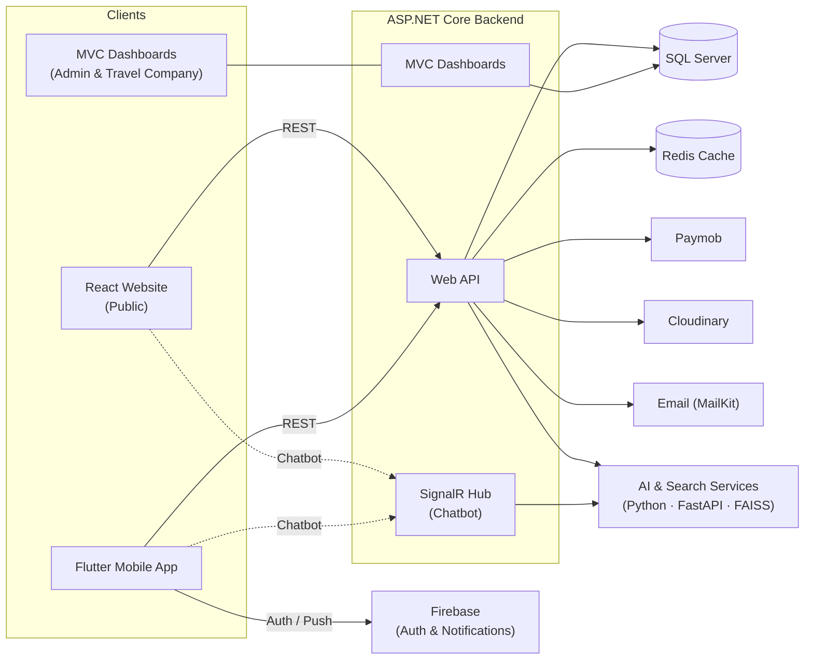

<div align="center">

# 🧭 JourneyMate

### *Discover Egypt. Book with confidence. Travel smarter.*

An AI-powered tourism platform that connects travelers with travel companies to promote domestic tourism in Egypt, through a public website, a Flutter mobile app, and dedicated management dashboards.


[🌐 Live Demo](https://lnkd.in/d8Phme_T) · [📘 API Documentation (Swagger)](https://lnkd.in/d4ua3xBN)

</div>

---

## 📑 Table of Contents

- [About the Project](#-about-the-project)
- [Key Features](#-key-features)
- [Screenshots and Demo](#-screenshots-and-demo)
- [System Architecture](#-system-architecture)
- [Technology Stack](#-technology-stack)
- [Backend Engineering Highlights](#-backend-engineering-highlights)
- [Application Workflows](#-application-workflows)
- [Repository Structure](#-repository-structure)
- [Getting Started](#-getting-started)
- [API Documentation](#-api-documentation)
- [Team Members and Contributions](#-team-members-and-contributions)
- [Development Methodology](#-development-methodology)
- [License](#-license)
- [Acknowledgments](#-acknowledgments)

---

## 🌍 About the Project

**JourneyMate** is a graduation project built to encourage domestic tourism in Egypt. It gives travelers a single place to discover trips, compare options, book, and pay online, while giving travel companies and platform administrators the tools to manage what they offer and oversee platform activity.

### The Problem

Egypt has an abundance of destinations, but trip discovery and booking are often fragmented across individual travel companies, social media pages, and direct messaging. Travelers have difficulty finding, comparing, and booking local trips in one place, and smaller travel companies have limited ways to reach them.

### Who It Is For

| Audience | Value |
|---|---|
| **Travelers** | Discover, search, and book domestic trips, with AI assistance for recommendations and planning. |
| **Travel companies** | A dedicated dashboard to publish trips and manage bookings. |
| **Administrators** | A dashboard to manage listings and oversee platform activity. |

### Role in Promoting Domestic Tourism

By bringing travel companies and travelers together on one platform, in both Arabic and English, JourneyMate aims to make Egyptian destinations easier to find and book for local travelers.

---

## ✨ Key Features

### 🧳 For Travelers

- Browse and discover trips on the website and the mobile app
- **Semantic search** that understands intent, not just keywords
- **AI-powered trip recommendations**
- **Itinerary assistance** and a **real-time chatbot**
- **Translation** and **summarization** of content
- Online booking with **Paymob** payments
- Interactive maps (React-Leaflet on web, Google Maps on mobile)
- Arabic and English interface
- Sign-in with email or Google (mobile, via Firebase)
- Push notifications on mobile

### 🏢 For Travel Companies

- Dedicated travel company dashboard
- Create and manage trip listings
- View and manage bookings received

### 🛠️ For Administrators

- Dedicated administration dashboard
- Manage listings and platform activity
- Oversee travel companies and users

> 📝 **To confirm:** the exact list of dashboard capabilities for each role. See [Missing Information](#-missing-information-to-confirm).

---

## 📸 Screenshots and Demo

> Replace each placeholder below with a real image path from your repository (e.g., `docs/screenshots/home.png`).

### 🌐 Website (React)

| Home | Trip Details | Booking |
|:---:|:---:|:---:|
| *Screenshot placeholder* | *Screenshot placeholder* | *Screenshot placeholder* |

### 📱 Mobile App (Flutter)

| Home | Chatbot | Trip Details |
|:---:|:---:|:---:|
| *Screenshot placeholder* | *Screenshot placeholder* | *Screenshot placeholder* |

### 🖥️ Dashboards (ASP.NET Core MVC)

| Admin Dashboard | Travel Company Dashboard |
|:---:|:---:|
| *Screenshot placeholder* | *Screenshot placeholder* |

### 🎬 Marketing Video

> *Video link placeholder. Add the link here if a marketing video is available.*

---

## 🏗️ System Architecture

JourneyMate is made up of several clients that talk to a central ASP.NET Core backend, which in turn works with the database, external services, and the AI/search services.

- The **public website** is a separate **React** application.
- The **administration and travel company dashboards** are **ASP.NET Core MVC** applications hosted in the backend. They are not part of the React website.
- The **Flutter mobile app** and the **React website** consume the backend's REST API.



> 📝 **To confirm:** how the backend and the AI services communicate (for example, whether the backend calls the FastAPI service over HTTP), and which clients connect to the SignalR hub. The diagram above reflects the most likely design based on the technology stack; adjust it to match the implementation.

---

## 🧰 Technology Stack

### Backend

| Technology | Purpose |
|---|---|
| ASP.NET Core Web API | REST API for the website and mobile app |
| ASP.NET Core MVC | Administration and travel company dashboards |
| Entity Framework Core + SQL Server | Data access and relational storage |
| Clean Architecture | Separation of concerns across layers |
| Specification Design Pattern | Reusable, composable query logic |
| JWT + role-based authorization | Authentication and access control |
| Redis | Caching |
| SignalR | Real-time chatbot communication |
| Paymob (Intention API) | Online payments |
| Cloudinary | Image hosting |
| MailKit | Email functionality |
| AutoMapper | Object-to-object mapping |

### Web Frontend

| Technology | Purpose |
|---|---|
| React 19 + TypeScript | Public website UI |
| Tailwind CSS | Styling |
| React Router v6 | Client-side routing |
| React-Leaflet | Interactive maps |
| react-i18next | Arabic and English localization |

### Mobile Application

| Technology | Purpose |
|---|---|
| Flutter + Dart | Cross-platform mobile app |
| Clean Architecture | Layered app structure |
| BLoC / Cubit | State management |
| Dio | HTTP client |
| Hive + secure storage | Local and sensitive data storage |
| Google Maps | Maps and locations |
| Firebase Authentication + Google Sign-In | User authentication |
| Push notifications | Notifying users |

### AI and Search

| Technology | Purpose |
|---|---|
| Python | AI service development |
| Hugging Face Transformers | Language models (chatbot, translation, summarization, embeddings) |
| FAISS | Vector similarity search for semantic search |
| FastAPI | Serving the AI and search capabilities as an API |

> 📝 **To confirm:** which specific Hugging Face models are used for each AI feature.

---

## ⚙️ Backend Engineering Highlights

| Concept | How it is used in JourneyMate |
|---|---|
| **Clean Architecture** | Organizes the backend into layers so business logic stays independent of frameworks, the database, and external services. |
| **SOLID principles** | Guide class and interface design to keep the code maintainable and easier to extend. |
| **Specification Pattern** | Encapsulates query criteria in reusable specification objects, keeping filtering and querying logic out of controllers and repositories. |
| **JWT authentication & role-based authorization** | Authenticates API users and restricts access according to roles (traveler, travel company, administrator). |
| **Redis caching** | Caches data to reduce repeated database reads. |
| **SignalR** | Provides real-time, two-way communication for the chatbot. |
| **Paymob Intention API** | Handles online payment for bookings. |
| **Cloudinary** | Stores and serves trip and listing images. |
| **MailKit** | Sends email from the platform. |
| **AutoMapper** | Maps between entities and DTOs. |

> 📝 **To confirm:** which data is cached in Redis, the exact role names, and the points in the booking flow where emails are sent.

---

## 🔄 Application Workflows

### Traveler Booking Journey

1. Discover trips through browsing, search, or AI recommendations.
2. Open a trip to view details, location, and company information.
3. Sign in or register.
4. Choose booking details and proceed to payment.
5. Pay online through **Paymob**.
6. Receive confirmation and track the booking.

### Travel Company Workflow

1. Sign in to the travel company dashboard.
2. Create and manage trip listings.
3. Review bookings made by travelers.

### Administrator Workflow

1. Sign in to the administration dashboard.
2. Manage listings and travel companies.
3. Monitor platform activity.

> 📝 **To confirm:** the exact steps, statuses (for example, booking states and listing approval), and whether companies need admin approval before publishing.

---

## 📂 Repository Structure

> 📝 **To confirm:** the repository structure has not been provided yet, so none is documented here to avoid listing paths that may not exist. Add the actual structure below, for example by running `tree -L 2` in each project.

```text
<Add the verified repository tree here>
```

---

## 🚀 Getting Started

> ⚠️ Setup details are intentionally left as placeholders. Fill in each section from the repository once confirmed.

### Prerequisites

> To confirm: required versions of the .NET SDK, SQL Server, Redis, Node.js, Flutter, and Python.

### Backend

> To confirm: clone instructions, configuration file(s) and settings (connection string, JWT, Redis, Paymob, Cloudinary, MailKit, Firebase), database migration commands, and the run command.

### Web Frontend

> To confirm: install and run commands and any environment variables.

### Mobile App

> To confirm: Firebase setup, Google Maps API key setup, and run commands.

### AI Services

> To confirm: dependency installation, model and index setup, and the command to start the FastAPI service.

---

## 📘 API Documentation

Interactive API documentation is available through Swagger:

👉 **[Open the Swagger documentation](https://lnkd.in/d4ua3xBN)**

The API uses JWT authentication together with role-based authorization.

> 📝 **To confirm:** how to obtain and send tokens (for example, the login endpoint and the `Authorization` header format) before documenting them here.

---

## 👥 Team Members and Contributions

JourneyMate was developed collaboratively by students from the **Faculty of Engineering, Tanta University**.

| Team Member | Contribution |
|---|---|
| Abdallah Elsaied | Backend Development |
| Abdallah Abdrabo | Backend Development |
| Abdallah Agag | Backend Development |
| Ahmed Tarek | AI Features |
| Abdallah Ibrahim / Abdallah Elghonamy | Team contribution as assigned during development |
| Ahmed Mahgoob | Web Frontend and Video Editing |
| Ola Belal | Web Frontend |
| Nada Omar | Mobile Application |
| Alaa Raslan | Mobile Application |

**Project Supervisor:** Dr. Nada Elshennawy

---

## 🔁 Development Methodology

The team followed an **Agile** approach, working through iterations, feedback, testing, and continuous refinement. The project brought together web development, mobile development, backend engineering, AI capabilities, and payment integration into a unified tourism experience.

---

## 📄 License

> **License to be confirmed.** Add a `LICENSE` file and update this section with the chosen license.

---

## 🙏 Acknowledgments

- **Dr. Nada Elshennawy**, our project supervisor, and the **Faculty of Engineering, Tanta University**
- The open-source communities behind ASP.NET Core, React, Flutter, Hugging Face, and FAISS
- The service providers used in the platform: Paymob, Cloudinary, and Firebase

---

<div align="center">

### *JourneyMate: your companion for exploring Egypt.* 🇪🇬

</div>
